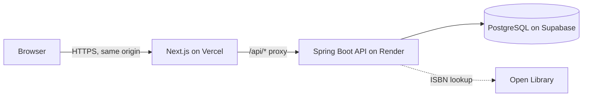

# Folio

**A library operations console. Every copy, accounted for.**

Folio runs the desk of a lending library: the catalogue, stock in and out, members, issues, returns, renewals and fines. Every stock movement is written to an append-only ledger that always adds up to the current shelf count.

## Demo accounts

Staff accounts only. Library members are records, not users: they don't sign in, and staff issue and return books on their behalf.

| Role | Email | Password |
|---|---|---|
| Admin (head librarian) | `admin@folio.dev` | `Admin@123` |
| Librarian (desk staff) | `desk@folio.dev` | `Desk@123` |

The sign-in page has one-click demo buttons for both.

## Features

| Brief requirement | Status |
|---|---|
| Books: create, view, update, delete, search, filter, sort | ✅ table and shelf (grid) views, ISBN auto-fill from Open Library, covers |
| Members: register and manage | ✅ status control, eligibility, printable card with QR code |
| Stock additions/reductions recorded in inventory history | ✅ append-only ledger, per-book timeline, global ledger with filters |
| Issue validates member eligibility and available stock | ✅ checkout-desk flow with eligibility panel and printable slip |
| Return validates the borrowing record and updates stock | ✅ fine preview before confirming; fines created automatically |
| ISBN uniqueness, stock limits, 3-book limit, 14-day loans | ✅ enforced in services and the database, covered by tests |

Also: renewals, fines (pay / waive), dashboard with KPIs and charts, ⌘K command palette, activity log, CSV export, dark mode, configurable library rules, keyboard shortcuts, and session management.

## Business rules

| Rule | Service | Database | Error code |
|---|---|---|---|
| Unique ISBN (normalised, checksum-validated, stored as ISBN-13) | `BookService` | `UNIQUE`, format `CHECK` | `DUPLICATE_ISBN`, `INVALID_ISBN` |
| Available ≤ total | `Book` stock methods | `CHECK` | `STOCK_LIMIT_EXCEEDED` |
| No negative stock | `Book` stock methods | `CHECK` | `INSUFFICIENT_STOCK`, `OUT_OF_STOCK` |
| Max 3 active loans | `CirculationService`, member row locked | — | `BORROW_LIMIT_REACHED` |
| One active copy of a title per member | `CirculationService` | partial unique index | `ALREADY_BORROWED` |
| 14-day loan | settings-driven, zone `Asia/Kolkata` | `CHECK` on settings | — |
| Issue/return update stock | same transaction as the loan | ledger `CHECK`s | — |
| Every stock change logged | `InventoryLedger` in the same transaction | arithmetic `CHECK`s, append-only trigger | — |

Issue also checks member status (`MEMBER_INACTIVE`), overdue loans (`HAS_OVERDUE_LOANS`) and unpaid fines over the limit (`FINE_LIMIT_EXCEEDED`). Concurrent issues of the last copy are serialised with row locks; a test fires two at once and asserts exactly one succeeds.

## Architecture



- **Auth:** short-lived JWT access tokens (15 minutes) held in memory only. Refresh tokens are random, stored as SHA-256 hashes, rotated on every use, and sent as an `HttpOnly; Secure; SameSite=Strict` cookie. Reusing a rotated token revokes the session. Every request checks that its session is still live, so sign-out and account deactivation take effect immediately. Accounts lock for 15 minutes after 5 failed sign-ins.
- **Same-origin proxy:** the browser only talks to the web app's own domain, which forwards `/api/*` to the API. That keeps the refresh cookie first-party.
- **Schema:** normalised (genres, publishers, authors, languages as reference tables; loan status derived from `returned_at`; fine amount generated from days × rate).

## Tech stack

Java 21, Spring Boot 4.2, Spring Security, Flyway, PostgreSQL · Next.js 16, TypeScript, Tailwind CSS 4, shadcn/ui, TanStack Query and Table, react-hook-form + zod, Recharts · JUnit 5, Testcontainers.

## Run locally

Prerequisites: Java 21, Node.js 20.9+, PostgreSQL 16+ (or Docker).

1. **Database:** create an empty database, e.g. `CREATE DATABASE "folio-db";`. Flyway creates the schema, and the demo library loads into an empty database. Without a local PostgreSQL, run `docker compose up -d` and use port 5433 with user/password `folio`.
2. **API** (port 8080):
   ```bash
   cd backend
   DB_URL=jdbc:postgresql://localhost:5432/folio-db DB_USERNAME=postgres DB_PASSWORD=your-local-password ./mvnw spring-boot:run
   ```
   API docs: http://localhost:8080/swagger-ui.html
3. **Web app** (port 3000):
   ```bash
   cd frontend
   cp .env.example .env.local    # API_ORIGIN=http://localhost:8080
   npm install
   npm run dev
   ```

See [.env.example](.env.example) for every variable.

## Tests

```bash
cd backend && ./mvnw verify                          # 47 unit + 60 integration tests on real PostgreSQL
cd frontend && npm run lint && npm run typecheck && npm run build
```

Integration tests use Testcontainers when Docker is available. Without Docker, set `TEST_DB_URL`, `TEST_DB_USERNAME` and `TEST_DB_PASSWORD` to an empty database.

## Deploy (Supabase + Render + Vercel)

**1. Supabase (database)**
1. Create a project and pick a region close to your Render region (e.g. Singapore).
2. Go to *Connect → Session pooler* and copy the host (port **5432**). Don't use the direct host (IPv6 only, unreachable from Render) or the transaction pooler (6543).
3. Your values will be:
   - `DB_URL=jdbc:postgresql://<pooler-host>:5432/postgres?sslmode=require`
   - `DB_USERNAME=postgres.<project-ref>`
   - `DB_PASSWORD=<database password>`

**2. Render (API)**
1. Push the repository to GitHub. In Render choose *New → Blueprint* and select the repo; `render.yaml` defines the service.
2. Fill in `DB_URL`, `DB_USERNAME`, `DB_PASSWORD`. Set `CORS_ALLOWED_ORIGINS` to your Vercel URL (set it after step 3, then redeploy). `JWT_SECRET` is generated for you.
3. Deploy and check `https://<service>.onrender.com/actuator/health` returns `{"status":"UP"}`. The first start runs the migrations and loads the demo data. Set `FOLIO_DEMO_DATA=false` for a real library.

**3. Vercel (web)**
1. Import the repo, set **Root Directory** to `frontend` (framework is detected).
2. Add the environment variable `API_ORIGIN=https://<service>.onrender.com` (no trailing slash, no `/api`).
3. Deploy, then copy the production URL into Render's `CORS_ALLOWED_ORIGINS` and redeploy the API.

**4. Keep the free API awake**

Render's free tier sleeps after 15 minutes idle, so the first request after a sleep takes 30–60 seconds.
- **GitHub Actions:** add a repository variable `API_HEALTH_URL=https://<service>.onrender.com/actuator/health` (*Settings → Secrets and variables → Actions → Variables*). `keep-alive.yml` pings it every 14 minutes. GitHub may delay scheduled runs and disables them after 60 days without repository activity.
- **External cron (recommended alongside):** at [cron-job.org](https://cron-job.org), create a job with that URL, method GET, every 14 minutes.
- One always-on service uses about 744 of Render's 750 free hours a month.

**Security checklist**
- Never commit `.env` files. Secrets live only in the Render and Vercel dashboards.
- Keep `AUTH_COOKIE_SECURE` at its default (`true`) in production.
- After going live, change or remove the demo accounts if the deployment is not meant for public demo use.

## Incomplete / known limitations

- Waitlists (reserving out-of-stock books) and CSV import are not implemented.
- Staff accounts are seeded; there is no staff management screen or password reset.
- Render's free tier cold-starts after inactivity (see the keep-alive step above).

More detail: [docs/DECISIONS.md](docs/DECISIONS.md) · [docs/API.md](docs/API.md)
